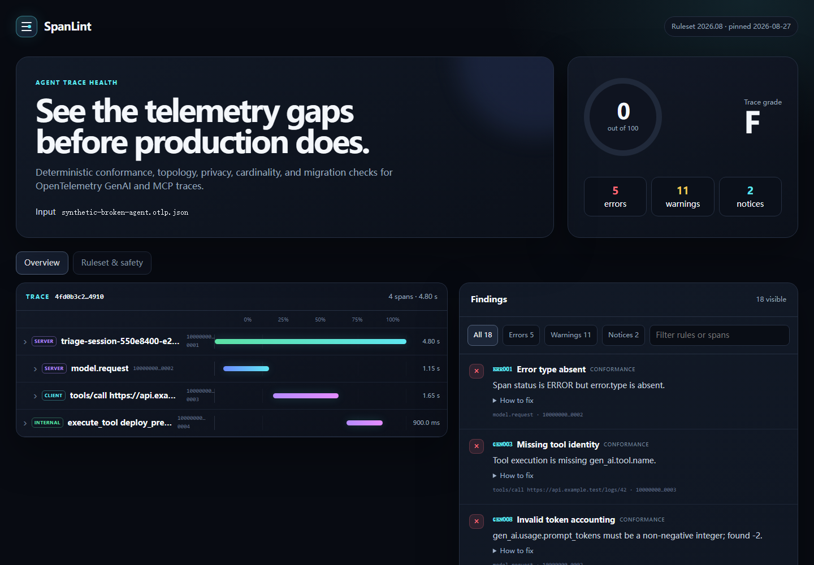

<div align="center">

# SpanLint

**Catch broken GenAI telemetry before production does.**

Deterministic CI linting and visual debugging for OpenTelemetry GenAI and MCP traces.

[](https://github.com/RRXXZZYY/spanlint/actions/workflows/ci.yml)
[](LICENSE)
[](#what-spanlint-checks)
[](#privacy-boundary)



</div>

LLM observability backends can store a trace. SpanLint answers a different question: **is this trace shaped well enough to debug, compare, and trust?**

It reads exported OTLP JSON or JSONL, applies a version-pinned rule pack, and produces a terminal gate or a self-contained visual report. No collector, account, model call, telemetry, or trace upload is required.

## Ten-second demo

```bash
npx --yes github:RRXXZZYY/spanlint demo
```

Open `spanlint-demo.html`. The synthetic broken trace is intentionally safe to share and shows every report surface.

Check your own export:

```bash
npx --yes github:RRXXZZYY/spanlint check trace.otlp.json --strict
```

Generate a report:

```bash
npx --yes github:RRXXZZYY/spanlint check trace.otlp.json \
  --format html \
  --out spanlint-report.html
```

Windows PowerShell works too; put the command on one line or use PowerShell's backtick continuation.

## What SpanLint checks

SpanLint ships 21 rules across six failure classes:

| Class | Examples |
| --- | --- |
| Conformance | required `gen_ai.operation.name`, `gen_ai.tool.name`, `mcp.method.name`, error identity |
| Trace structure | missing parents, impossible timing, duplicate spans, detached tools, double instrumentation |
| Quality | model identity, token usage, span naming and kind, MCP protocol version |
| Privacy | opt-in prompts, messages, tool arguments/results, retrieval and memory content |
| Cardinality | request URLs, UUIDs, and resource-specific values leaking into span names |
| Migration | legacy GenAI attributes with concrete replacements |

The rule pack targets an exact snapshot of the OpenTelemetry GenAI semantic conventions, currently commit [`67dff02`](https://github.com/open-telemetry/semantic-conventions-genai/commit/67dff024110be5bd9f318006e733f4078e0f4c97) from 2026-08-27. The upstream conventions are in development, so SpanLint pins rather than silently follows `main`.

Run `spanlint rules` for the full list or `spanlint explain MCP004` for one rule. See [the rule reference](docs/rules.md) for severity and rationale.

## Input support

- OTLP JSON export with `resourceSpans → scopeSpans → spans`
- OpenTelemetry JSONL / file-exporter style records
- Arrays of OTLP payloads
- Flat span objects with OTLP camelCase or snake_case fields
- Standard OTLP `AnyValue` attributes, including arrays and key-value lists

Multiple files can be checked together:

```bash
spanlint check traces/agent.json traces/mcp.json --strict
```

## CI and GitHub Code Scanning

Use the included action:

```yaml
name: agent-telemetry
on: [push, pull_request]

jobs:
  spanlint:
    runs-on: ubuntu-latest
    steps:
      - uses: actions/checkout@v7
      - uses: RRXXZZYY/spanlint@v0.1.0
        with:
          path: traces/*.json
          strict: "true"
```

Or emit SARIF and upload it with GitHub's CodeQL action:

```bash
spanlint check traces/*.json --format sarif --out spanlint.sarif
```

JUnit and JSON are also available:

```bash
spanlint check trace.json --format junit --out spanlint.junit.xml
spanlint check trace.json --format json --out spanlint.json
```

Exit codes are stable: `0` passes, `1` is a rule-gate failure, and `2` is invalid usage or input. By default errors fail; `--strict` makes warnings fail too.

## Privacy boundary

SpanLint is local and deterministic. The CLI does not make network requests.

HTML reports redact all OpenTelemetry opt-in content attributes, including messages, prompts, tool arguments/results, retrieval documents, and memory records. Keys that look like credentials, cookies, authorization headers, or access tokens are also redacted.

Redaction is defense in depth, not a data-loss-prevention guarantee. Trace metadata and custom attributes may still be sensitive. Review a report before sharing it and keep production traces under appropriate access controls and retention rules.

Use `--privacy strict` to promote content-capture notices to warnings, or `--privacy off` when another policy engine owns that decision. Attribute values remain redacted from HTML in every mode.

## Honest scoring

The score is deliberately simple and inspectable:

- error: −15
- warning: −5
- privacy notice: −1
- floor: 0

Grades are A ≥ 90, B ≥ 75, C ≥ 60, D ≥ 40, otherwise F. This is a triage heuristic—not an OpenTelemetry certification, security proof, model evaluation, or production-readiness claim.

## Development

Requirements: Node.js 20 or newer.

```bash
npm install
npm test
npm run demo
```

The project uses TypeScript with zero runtime dependencies. The generated `dist/` is committed so the repository itself can be used as a GitHub Action and through `npx github:` without a registry publish.

Architecture, design tradeoffs, and extension points are documented in [docs/architecture.md](docs/architecture.md). The evidence-backed 2026 direction analysis is in [docs/research-2026.md](docs/research-2026.md).

## Why this project

The short version: AI infrastructure and observability skills are hiring signals, while full observability platforms and generic Agent/MCP wrappers are already crowded. A narrow, deterministic trace-quality gate is small enough to become useful quickly and deep enough to demonstrate protocol, telemetry, CI, privacy, and product engineering.

The project does not claim users, stars, adoption, or benchmark wins. If it helps your instrumentation, a minimal failing fixture is the most useful contribution.

## License

MIT. SpanLint is independent and is not affiliated with or endorsed by OpenTelemetry or the Model Context Protocol project. See [third-party notices](THIRD_PARTY_NOTICES.md).
