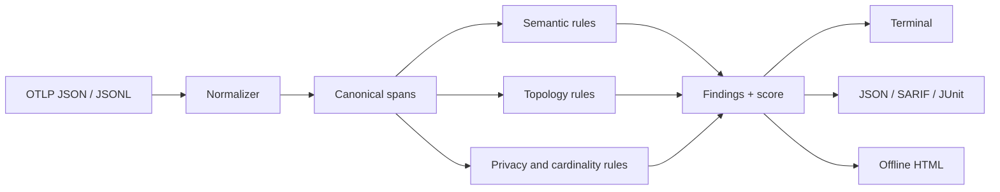

# Architecture

SpanLint keeps the trust boundary small: files go in, deterministic artifacts come out.

## Modules

- `src/otlp.ts` decodes OTLP `AnyValue` fields and normalizes standard, array, flat, and JSONL layouts.
- `src/spec.ts` is the explicit rule catalog and the pinned upstream provenance.
- `src/rules.ts` performs per-span semantic checks and per-trace topology checks.
- `src/report/formats.ts` produces terminal, JSON, SARIF, and JUnit output.
- `src/report/html.ts` builds a self-contained interactive timeline and findings report.
- `src/cli.ts` owns stable commands, formats, and exit codes.

There are no runtime dependencies. That keeps GitHub Action use, install review, and supply-chain surface easy to inspect.

## Normalized model

Every input becomes a `NormalizedSpan` containing:

- trace, span, and parent IDs;
- name, kind, timestamps, duration, and status;
- decoded span and resource attributes;
- instrumentation scope and schema URL;
- source basename and source index.

Absolute source paths are discarded at ingestion. BigInt timestamps remain exact internally and become decimal strings in JSON output.

## Rule design

Rules have stable IDs, default severity, category, explanation, remediation, and—where applicable—a URL pinned to the exact upstream commit.

The evaluator separates:

- required convention violations (`error`);
- recommended observability quality (`warning`);
- opt-in content visibility (`info`, or `warning` under strict privacy).

Project heuristics such as detached tools and high-cardinality names are labeled as structure/cardinality checks rather than presented as upstream requirements.

## HTML safety

The report has no remote fonts, scripts, styles, or telemetry. Dynamic values are HTML-escaped. Embedded JSON escapes characters that could terminate a script block.

Before serialization, the renderer redacts:

- all known OpenTelemetry opt-in content attributes;
- attribute names that resemble secrets, credentials, authorization, cookies, or access/refresh tokens.

The renderer intentionally does not promise universal DLP. Custom metadata can still be sensitive.

## Extension strategy

New rules should be small and testable:

1. Add metadata in `src/spec.ts`.
2. Add the deterministic check in `src/rules.ts`.
3. Add a minimal synthetic fixture or focused unit test.
4. State whether the rule is an upstream requirement, recommendation, or SpanLint heuristic.
5. Link an immutable upstream source when the rule derives from a convention.

Live OTLP ingestion is deliberately out of the core. It can be added later as a thin adapter that emits the same normalized model.
